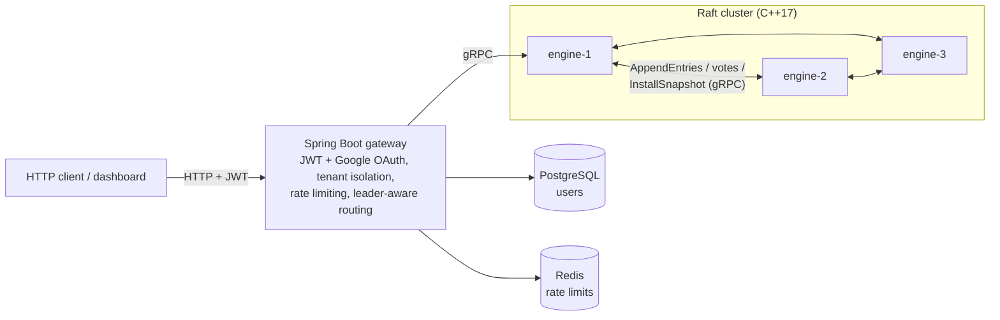

# AetherDB-Platform

AetherDB-Platform is a production-grade, highly concurrent, secure, and persistent key-value platform. It orchestrates a **3-node Raft-replicated** C++17 sharded database engine, a PostgreSQL user registry, and a Java Spring Boot 3 API Gateway implementing JWT authentication, multi-tenant isolation, non-blocking connection pooling, and automatic leader-failover routing.

---

## 🏗️ System Architecture & Data Flow



- **aether-gateway**: the single entry point. Handles authentication and issues JWTs, keeps each tenant's keys separate, and routes requests over gRPC to the current Raft leader.
- **aether-engine**: the sharded, write-ahead-logged storage engine, replicated across three nodes with Raft, on a private Docker network that isn't reachable from the host.
- **postgres**: user accounts, with passwords hashed with BCrypt. **redis**: rate-limit buckets for the login endpoints.

📖 **Documentation:** [`docs/`](docs/README.md): architecture, Raft internals, API reference, operations, testing and findings.

> **Setup note:** the gateway needs `AETHER_JWT_SECRET` in a gitignored `.env` file (generate one with `openssl rand -hex 32`). See [Getting started](docs/getting-started.md).

---

## 🔒 Production-Grade Design & Security Justifications

### 1. Sharded Locks instead of one Mutex (C++ Engine)
* **What breaks:** Protect a single map with a single lock. Under high concurrent write loads, threads block waiting for the table-wide mutex. Furthermore, dynamic map rehashing can corrupt the bucket pointers and cause segfaults in threads concurrently reading other keys.
* **The Architecture:** The keyspace is sharded across 16 independent map buckets, each guarded by its own read-write `std::shared_mutex`. Rehashes are localized, and contention is minimized.

### 2. Length-Prefixed Binary-Safe Framing (C++ Persistence)
* **What breaks:** Write WAL transactions as raw text separated by spaces or newlines. If a value contains space or newline characters, parsing fails during crash recovery and corrupts the state.
* **The Architecture:** Transactions are stored using length-prefixed headers (`S\n<keylen>\n<key><vallen>\n<val>`). The parser reads the exact number of bytes specified by the length prefixes, allowing raw binary values.

### 3. Log-Before-Apply Ordering
* **What breaks:** Update the in-memory map first, then log to the WAL. If the server crashes in between, the client gets a success confirmation, but the transaction is lost forever on reboot.
* **The Architecture:** Update entries are written and `fsync`'ed to disk *before* updating the memory structure. Replay on boot guarantees correctness.

### 4. Non-Blocking High-Concurrency Gateway Routing (Java Client Pool)
* **What breaks:** Using standard `synchronized` wrapper declarations across Java network clients forces the application to process every database request sequentially. This creates a severe processing bottleneck at the entry gate, rendering the C++ sharded locking engine useless.
* **The Architecture:** We built a dedicated, thread-safe connection pool using an internal `BlockingQueue<Socket>`. Threads check out long-lived, pre-allocated socket lines to run concurrent queries completely in parallel before returning them to the pool queue.

### 5. Length-Prefixed Key Multi-Tenancy Defenses
* **What breaks:** Using a simple character delimiter to split tenant identities (e.g., `tenantId + ":" + key`) allows an attacker to inject matching delimiter patterns inside user inputs. A user could intentionally look up a key like `:tenant_2:secret` from `tenant_1`'s account to escape their database isolation bubble.
* **The Architecture:** We adopted our C++ binary logging strategy directly into our Java layer, encoding keys with an explicit length prefix (`len:tenantId:key`). The system parses keys by measuring character lengths instead of searching for character tokens, neutralizing all injection attack paths.

### 6. Zero-Trust Network Topologies
* **What breaks:** Securing your infrastructure only at the API web gateway leaves internal database ports vulnerable if the core network engine is exposed directly on the host interface. Anyone with raw terminal access (`nc` or `telnet`) can connect to port 8080 and wipe the engine data entirely.
* **The Architecture:** The C++ binary operates inside an isolated Docker bridge network (`aether-mesh`). Sockets bind to internal interfaces, meaning the database cannot be queried directly from the internet, protecting data integrity.

### 7. Raft Consensus Replication (C++ Engine Cluster)
* **What breaks:** A single engine process is a single point of failure — kill it and the platform is down until it restarts, and any un-snapshotted data relies on one disk surviving.
* **The Architecture:** Three engine nodes run the Raft consensus protocol (leader election + majority-commit log replication), implemented from scratch in C++17. The **existing WAL doubles as the Raft log**: records carry a `term` and `index`, the leader streams them to followers via AppendEntries, and each follower persists them through the same fsync'd WAL machinery used for crash recovery — one mechanism, two jobs (durability *and* replication). A write is acknowledged only after a majority of nodes have it on disk, so killing the leader mid-load loses **zero acknowledged writes** (verified by test, including under concurrent multi-writer load — see below).
* **Peer RPC transport: gRPC.** `RequestVote`/`AppendEntries` between engine nodes run over gRPC (`aether-engine/proto/raft.proto`), not a hand-rolled socket protocol — a deliberate transport swap once the hand-rolled version was proven correct, to demonstrate knowing when *not* to hand-roll infrastructure. This was a pure transport migration: zero changes to election rules, the commit rule, log-conflict truncation, or the WAL, verified by rerunning the exact same `raft_demo.py`/`raft_safety_test.py` suites unchanged before/after and confirming identical PASS criteria.
* **Client data-path transport: also gRPC.** The gateway-engine `SET`/`GET`/`DEL` path (`aether-engine/proto/client.proto`, gateway's `AetherEngineClient.java`) migrated the same way, as a deliberate fast-follow once the Raft peer migration proved the pattern. `STATUS` and the raw-TCP text protocol stay on the original port 8080 (a genuinely different concern — introspection/diagnostics, not the client data path — and the interface `raft_demo.py`/`raft_safety_test.py` depend on directly), while `SET`/`GET`/`DEL` moved to a new gRPC service on port 8080+2000. Verified the same way: the unchanged `raft_demo.py` passing end-to-end through the gateway is direct proof the new client gRPC path works correctly under real failover, and `raft_safety_test.py` (which talks the raw-TCP protocol directly) confirms that path is untouched.
* **Measured failover time**: **~1.0–2.4 seconds** across independent runs against the live Docker cluster (best observed: 999ms; typical: ~2.35s), measured precisely from the `docker kill` timestamp to a new leader confirmed via `STATUS`, printed by `raft_demo.py` on every run. Consistent with the 800–1600 ms randomized election timer plus RPC overhead; the high end of the range tracks host CPU contention (this was measured on a dev machine also running Docker Desktop's own Kubernetes control plane, which independently used 40–70% CPU during some runs) rather than anything in the Raft implementation itself.

* Key mechanics, per the Raft paper:
  - Randomized election timeouts (800–1600 ms) with heartbeats every 250 ms; exactly one leader per term.
  - Election restriction (§5.4.1): only candidates with an up-to-date log can win, so a stale rejoining node can never overwrite committed data.
  - Leader appends a no-op entry on election so prior-term entries become committable after failover.
  - Followers detect log conflicts and truncate their WAL from the divergence point. Only committed entries are ever applied, including after a restart: on startup only the snapshot is known committed, and the rest is applied once a leader confirms it.
  - Followers answer writes/reads with `ERR NOT_LEADER <host:port>`; the gateway follows the redirect, remembers the leader, and rotates through `AETHER_ENGINE_NODES` seeds when the leader dies. `NOT_LEADER` always means "nothing was written"; a write whose fate is unknown (leadership lost after appending it) returns `TIMEOUT` instead.
  - **Linearizable reads (ReadIndex, thesis §6.4):** a GET is answered only after a majority acknowledges a heartbeat round sent *after* the read began. A leader cut off by a partition can't do that, so it returns `TIMEOUT` instead of stale data.
  - **CheckQuorum:** a leader that hasn't heard from a majority within the election-timeout window steps down instead of believing it leads forever.
  - **PreVote (thesis §9.6):** a node checks it could win before raising its term, so a node cut off by a partition can't inflate its term and depose a healthy leader when it reconnects.
  - **Log compaction + InstallSnapshot:** after `AETHER_SNAPSHOT_THRESHOLD` (default 1000) applied entries, a node writes a Raft-indexed snapshot and drops the WAL prefix it covers; followers that fall behind the compacted log are rebuilt with an `InstallSnapshot` RPC.

### 7b. Partition Testing + Linearizability Checking
* **What breaks:** "kill the leader, watch a new one win" is the easy case. In a network partition the old leader stays *up* but cut off, still believes it leads, and keeps answering clients.
* **The harness** (`aether-engine/scripts/partition_test.py`): real packet-level partitions via `iptables` inside the containers, concurrent clients recording every operation's call/return time, and **[Porcupine](https://github.com/anishathalye/porcupine)** (the checker used by MIT 6.5840 and etcd) deciding whether the history is linearizable. Plus an exact cross-node state hash (`DIGEST`) for convergence.
* **The headline: the Raft above had three real bugs**, despite passing every crash test written for it. It had been *demoed*, not *verified*. Found the first time it was partitioned with a linearizability checker, and reproduced on the unmodified code before anything was fixed:
  1. **Consensus safety:** a crash-restart applied 5 *uncommitted* entries (`commit` 21→26), at log indexes where the majority had applied different entries. That violates Raft's State Machine Safety property.
  2. **Linearizability:** a leader cut off from its peers kept serving reads from stale state (Porcupine: **NOT LINEARIZABLE**, violations proven on 2 of 5 keys).
  3. **Availability:** an isolated follower inflated its term (2→9), forcing a needless election on heal (cluster at term 12).

  No acknowledged write was lost in any run, and that was checked, not assumed.
* **Fixed with ReadIndex, CheckQuorum, PreVote and a corrected restart path**, plus log compaction with InstallSnapshot. Verified in **one uninterrupted end-to-end pass** with a sentinel container proving Docker never restarted mid-run: **LINEARIZABLE** with every operation covered (4,462/4,462 with the leader cut off; 6,922/6,922 under 45 s of random partitions), the checker's exit code and `OOMKilled=false` read back from Docker, term stays at 1, a follower behind the compacted log rebuilt via InstallSnapshot, WAL 2,073 bytes after 1,500 writes (was 41,698 and growing). The pre-existing chaos, safety and failover suites still pass. Full before/after, including five mistakes in the test harness itself that were caught before they became claims, is in **[`CHAOS_TESTING.md`](CHAOS_TESTING.md#network-partitions--linearizability)**.

### 8. Group-Commit fsync (Write Throughput Optimization)
* **What breaks:** every `SET` calls `fsync()` synchronously while holding Raft's own state mutex — since that mutex serializes all Raft activity, this meant concurrent client writes were **already fully serialized one fsync at a time**, with no way for two writes to ever share a disk sync. Measured baseline: **90.5 ops/sec** under 20 concurrent gateway clients (`gateway_concurrent_load_test.py`), consistent with ~22ms/write on this machine's virtualized Docker Desktop/WSL2 storage.
* **The fix:** `WalManager` gained group-commit primitives (`append_entry_buffered`/`wait_for_durable`/a background flusher thread) so the leader's `propose()` releases its mutex between appending an entry and durably syncing it — letting concurrent proposals share one `fsync()` batched over a bounded 5ms window (or 64 entries, whichever first). The follower's `AppendEntries` handler got the simpler half of this: batching one RPC's entries into a single `fsync()` without any lock-scope change at all, since it only ever processes one RPC at a time. **Zero changes to election, commit, or conflict-truncation logic** — a pure I/O optimization underneath already-correct logic, mirroring the same "verify nothing else changed" discipline used for both gRPC transport migrations.
* **A useful discovery, not just an implementation:** the plan this followed assumed AppendEntries batching (grouping multiple log entries into one RPC) would need to be built separately — it turned out to already exist in `send_append_entries_to_locked`, which already packs every unacknowledged entry into one call. It simply had nothing to batch before, since the mutex serialization meant there was normally only ever one pending entry. Once group-commit let concurrent proposals pile up before broadcasting, that existing code started batching for free. Confirmed by the throughput result below, not assumed.
* **Measured result**: **194–376 ops/sec** across two independent runs (same 20-thread/25-op load test, unchanged) — a **2.1×–4.2× improvement** over the 90.5 ops/sec baseline, with 1000/1000 ops succeeding and zero errors both times. `raft_safety_test.py`'s full zero-loss guarantee (mid-load leader kill, follower catch-up, 8-thread concurrent writers) was reverified unchanged and still passes identically — the speedup did not cost any durability.
* A new isolated unit test (`wal_v2_test.cpp`, `test_group_commit_concurrent`) exercises the new primitives directly — 20 threads writing concurrently, verifying zero loss — before trusting the full Raft integration test to catch a bug in them. It caught one for real during development: the flusher's background thread only woke on a "batch full" signal, which a moderate write volume could never trigger, hanging every writer forever. Fixed by notifying on every write, not just when the batch fills.

### 9. Backup/Restore + Chaos Testing (Disaster Recovery, Independent of Raft)
* **What breaks:** Raft protects against losing a *minority* of nodes — the cluster keeps working, no committed data lost. It does **not** protect against losing a *majority* at once (e.g. all 3 node volumes on one dev machine's disk failing simultaneously). This is a completely independent safety net for exactly that scenario.
* **The tooling:** a `SNAPSHOT_EXPORT` engine command plus `aether-engine/scripts/backup.py` / `restore.py`. In cluster mode `SNAPSHOT_EXPORT` takes a real Raft-indexed snapshot (and compacts the WAL prefix it covers). A backup is snapshot + remaining WAL, copied WAL-first so a concurrent auto-compaction can't leave a gap. Zero new recovery code: restore just places the right files before the engine's normal startup path (load snapshot, replay the WAL tail) runs.
* **The real, honest finding**: restoring a backup into just *one* node risks the other nodes (if genuinely empty) achieving majority *between themselves* and overruling the restored node's history — correct Raft behavior, not a bug, but it means the right disaster-recovery procedure is to restore into a **majority** of nodes. Discovered by actually running the failure case, not by inspection — see `CHAOS_TESTING.md` for the full account.
* **Proven for real**: full destroy-all-3-volumes-and-restore demonstrated against the live cluster — pre-disaster data confirmed present, cluster confirmed fully functional (new writes succeed) afterward.
* **Chaos suite** (`aether-engine/scripts/chaos_suite.py`, 5 scenarios): follower kill mid-load, below-quorum negative test (the survivor must never elect itself — confirmed, not assumed), kill mid-snapshot-write, simulated slow peer link, and a 5x restart storm. All 5 run for real with pass/fail and actual observed behavior recorded in **[`CHAOS_TESTING.md`](CHAOS_TESTING.md)**.

### Live Failover Demo
With the stack running (`docker compose up --build`), run the scripted demo. It
authenticates and writes real data **through the gateway** (the actual client
path, not a raw engine connection), then:
1. Prints every node's `STATUS` (role/term/commit).
2. Writes N keys via the gateway, `docker kill`s the current leader, and polls
   the survivors' `STATUS` to measure the precise election-to-recovery delta in ms.
3. Verifies every pre-kill write is still correct via the gateway.
4. Writes M more keys **while the old leader is still down**.
5. `docker start`s it back, waits for it to rejoin, then reads its on-disk WAL
   directly (a follower doesn't serve `GET`) to confirm it caught up on
   **both** the pre-kill and the during-downtime writes.
```bash
cd aether-engine/scripts
python3 raft_demo.py            # --num-keys / --downtime-keys to change volume
```
This is a repeatable, rerunnable script — safe to run live in an interview
without typing commands by hand. Sample real output:
```
MEASURED ELECTION-TO-RECOVERY DELTA: 2351.2 ms
PASS: all 30 pre-kill acknowledged writes correct on new leader.
PASS: rejoined node's WAL contains all 45 acknowledged keys (30 pre-kill + 15 written during its downtime).
PASS: full failover demo succeeded.
```
Note: the script reads a follower's WAL directly for step 5, so it reproduces
the gateway's tenant-key encoding (`len(tenantId):tenantId:userKey` — see
`StorageService.buildIsolatedKey`) rather than searching for the raw key.

### Automated Safety Tests
Two Python integration tests exercise the safety properties directly against
local (non-Docker) processes, no manual steps required:
- `aether-engine/scripts/raft_chaos_test.py` — basic write/kill/failover/rewrite smoke test.
- `aether-engine/scripts/raft_safety_test.py` — the rigorous proof:
  1. **Mid-load leader kill** (120 sequential writes, leader `kill -9`'d at write #40): every acknowledged write survives on the new leader.
  2. **Follower catch-up**: a follower killed for 40 writes, then restarted, converges its WAL to match the leader exactly.
  3. **Concurrent writers**: 8 threads (200 writes total) hammering the leader simultaneously, leader killed mid-flight: every acknowledged write survives. This specifically rules out concurrency bugs in overlapping in-flight proposals racing a crash — a different failure mode than sequential loss, though not a different safety guarantee (majority-commit-before-ack is what prevents loss either way).

Run either with:
```bash
cd aether-engine
mkdir -p build && cp <path-to-built-AetherDB-binary> build/
python3 scripts/raft_safety_test.py
```
`aether-engine/scripts/raft_chaos_test.py` runs the same scenario as an automated local test (3 processes, no Docker needed).

A fourth script, `aether-engine/scripts/gateway_concurrent_load_test.py`, targets a different concern: genuine concurrent client load through the **gateway's gRPC client path** specifically (`AetherEngineClient`, added in Phase B), as opposed to Raft-layer concurrency. N threads issue SET+GET pairs simultaneously over their own persistent HTTP connections against the live gateway; it verifies zero errors/lost/corrupted writes and reports real throughput. Run against a live `docker compose up` stack:
```bash
python3 aether-engine/scripts/gateway_concurrent_load_test.py --threads 20 --ops-per-thread 25
```
Sample real results: **90.5 ops/sec** before the group-commit fsync optimization (see §8 above), **194–376 ops/sec** after — same test, same parameters, 1000/1000 ops and zero errors both times. SETs are consensus-bound (each requires a WAL fsync plus majority replication before the gateway gets `OK`), so this number is a direct, repeatable measure of Raft commit latency, not a client-path artifact.

### Honest Limitations / Future Work
- **Snapshots are sent whole**: `InstallSnapshot` ships the entire state in one gRPC message (receive limit raised to 256MB), and snapshotting copies the state in memory first. Fine at this project's data sizes; a large dataset would need chunked transfer and copy-on-write/incremental snapshots.
- **Every GET pays a heartbeat round trip** (ReadIndex). Leader leases would avoid it but depend on bounded clock drift; ReadIndex was chosen because it is correct without that assumption.
- **No dynamic membership changes**: the 3-node topology is fixed at deploy time.
- **No follower reads**: all reads are served by the leader for consistency; follower reads (also via ReadIndex) would be a throughput win.
- **Partition tests are symmetric and node-level**: one-way (asymmetric) partitions, packet loss/latency (`tc netem` is installed in the image but no scenario uses it yet), and clock skew are not tested.
- **`STATUS`/diagnostics stay on the raw-TCP protocol**: only `SET`/`GET`/`DEL` moved to gRPC. `STATUS` and the underlying text protocol are a deliberately separate, unmigrated concern (see above) — used directly by `raft_demo.py`/`raft_safety_test.py` for introspection, not worth forcing onto gRPC (would need a Python `grpcio` dependency) for zero functional benefit.
- **`aether-engine/proto/client.proto` is duplicated**, not shared: once at `aether-engine/proto/` (canonical) and once at `aether-gateway/src/main/proto/` (copy, since the gateway's Docker build context can't see the engine's proto directory without restructuring both Dockerfiles). Manual sync risk on future proto changes — a real, acknowledged trade-off, not an oversight.

---

## 🚀 Setup and Deploy

### Prerequisites
- Docker & Docker Compose

### Step 1: Start the Platform
First create a `.env` file in the repository root (it is gitignored) with a JWT signing secret; the stack refuses to start without one:
```bash
echo "AETHER_JWT_SECRET=$(openssl rand -hex 32)" >> .env
```
Then, from the directory containing `docker-compose.yml`:
```bash
docker compose up --build
```
This builds and starts the three engine nodes, PostgreSQL, Redis and the Spring Boot API gateway.

### Step 2: Register a Tenant
```bash
curl -X POST http://localhost:8080/auth/register \
     -H "Content-Type: application/json" \
     -d '{"username":"tenant_1","password":"password123"}'
```

### Step 3: Login to Obtain JWT
```bash
JWT=$(curl -X POST http://localhost:8080/auth/login \
     -H "Content-Type: application/json" \
     -d '{"username":"tenant_1","password":"password123"}' | jq -r '.token')
```

### Step 4: Write and Read Isolated Keys
Write key-value pair:
```bash
curl -X POST "http://localhost:8080/api/v1/storage?key=username" \
     -H "Authorization: Bearer $JWT" \
     -H "Content-Type: text/plain" \
     -d "aravind"
```

Read key-value pair:
```bash
curl -H "Authorization: Bearer $JWT" http://localhost:8080/api/v1/storage/username
```
