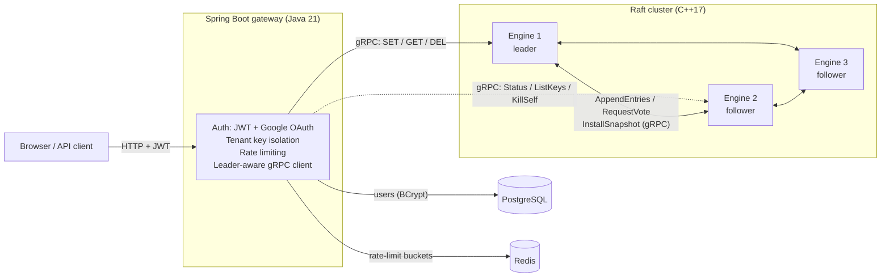

# Architecture

## System overview



Everything runs on one private Docker network (`aether-mesh`). Only the
gateway's port 8080 is published to the host. The engines, PostgreSQL and
Redis can't be reached from outside.

## Ports

| Port | Where | Used for |
|---|---|---|
| 8080 | gateway (published) | REST API and dashboard |
| 8080 | each engine (internal) | Plain-text diagnostic protocol: `STATUS`, `DIGEST`, `SNAPSHOT_EXPORT`, and `SET`/`GET`/`DEL` for test scripts |
| 9080 | each engine (internal) | Raft peer RPCs over gRPC (client port + 1000) |
| 10080 | each engine (internal) | Client gRPC: `AetherClient` and `AetherAdmin` services (client port + 2000) |

## The storage engine (`aether-engine`)

One C++17 binary. In cluster mode every node runs the same code.

### In-memory store: sharded map

The keyspace is split across **16 shards**, each a hash map with its own
reader-writer lock (`std::shared_mutex`). Writes to keys in different
shards never wait on each other, and a hash-map resize only affects one
shard. (`include/LockManager.hpp`)

### Durability: write-ahead log (WAL)

Every change is appended to `aether.wal` and **`fsync`ed before it is
applied** to memory, so a crash can never lose a write that a client was
told succeeded. Records are length-prefixed
(`op, term, index, key length, key, value length, value`), so keys and
values can contain any bytes, including newlines. (`src/Persistence.cpp`)

**Group commit.** Concurrent writes share one `fsync`: a background flusher
waits up to 5 ms, or 64 entries, then syncs once for all of them. This took
write throughput from 90.5 to 194–376 ops/sec.

### Replication: Raft

The WAL doubles as the Raft log: each record carries its Raft term and
index. A leader replicates entries to followers, and an entry is committed
once a majority (2 of 3) has it on disk. See
[Consensus (Raft)](./raft.md).

### Snapshots

Once 1,000 applied entries pile up (configurable), a node writes the whole
state to `aether.snapshot`, tagged with the log index it covers, and drops
that part of the WAL. A follower that needs entries the leader has already
dropped is sent the snapshot instead.

### Files on disk (per node, in `/data`)

| File | Contents |
|---|---|
| `aether.wal` | Log entries after the last snapshot |
| `aether.snapshot` | Full state as of a log index (header `RS2`, then index and term) |
| `raft.meta` | Current term and who this node voted for |

## The gateway (`aether-gateway`)

A Spring Boot 3 application on Java 21.

- **Authentication.** Username/password (BCrypt hashes in PostgreSQL) or
  Google OAuth. Successful login returns an HS256-signed JWT, valid for
  24 hours. The signing secret comes from the `AETHER_JWT_SECRET`
  environment variable.
- **Tenant isolation.** Every key is stored as `len:tenant:key`, for
  example `5:alice:greeting`. The length prefix means a key containing `:`
  can't spill into another tenant's namespace.
- **Rate limiting.** `/auth/register`, `/auth/login` and the OAuth callbacks
  allow 5 requests per minute per client IP (Bucket4j with buckets in
  Redis).
- **Leader-aware routing.** The gateway talks gRPC to the engines. If it
  reaches a follower, the reply says `NOT_LEADER` plus the leader's
  address, and the gateway retries there. If a node is unreachable, it
  rotates to the next one in `AETHER_ENGINE_NODES`.
- **Cluster admin.** A separate client queries every node's status for the
  Cluster Console and sends `KillSelf` to the leader for the chaos demo.

## The dashboard

Static HTML and JavaScript served by the gateway:

- **Console** (`index.html`): key-value operations, showing the shard and
  replication count for each write.
- **Cluster Console** (`cluster.html`): live topology, Kill Leader, a key
  browser and batch writes.

## Repository layout

```
aether-engine/
  include/, src/       C++ engine: Raft, WAL, sharded store, servers
  proto/               raft.proto, client.proto, admin.proto
  tests/               WAL unit tests, gRPC smoke tests
  scripts/             test harnesses, failover demo, backup/restore
    linearizability/   Porcupine checker (Go)
aether-gateway/        Spring Boot gateway and dashboard
docs/                  this documentation (VitePress)
docker-compose.yml             the platform
docker-compose.chaos.yml       overlay used only by the partition tests
CHAOS_TESTING.md               full test results and evidence
```
