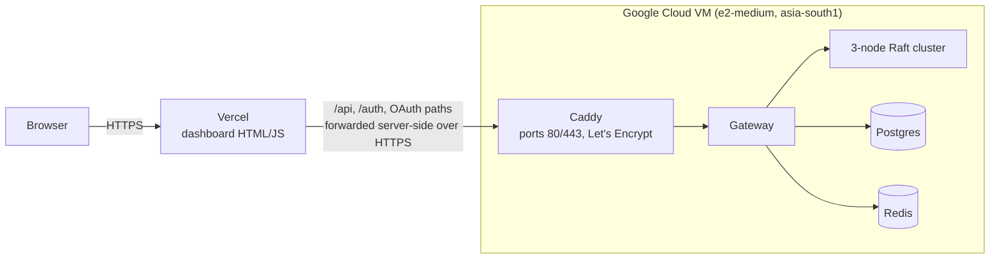

# Deployment

**Live: https://aetherdb.vercel.app**

## How it's hosted



- **Vercel** serves the dashboard's static files (`aether-gateway/src/main/resources/static`).
  It forwards `/api/*`, `/auth/*` and the OAuth paths to the backend
  server-side, so the browser only ever talks to one HTTPS origin. That
  means no CORS setup, no mixed-content blocking, and no frontend code
  changes, since the dashboard already uses relative URLs.
- **The backend** is the normal `docker compose` stack on one VM, plus
  Caddy as the only public entry point. Caddy gets a Let's Encrypt
  certificate automatically for the VM's `sslip.io` hostname (a free DNS
  name that resolves to the IP inside it). The gateway, engines, Postgres
  and Redis aren't reachable from the internet; the firewall allows only
  ports 80 and 443.

Vercel can't host the backend itself: it runs static files and short-lived
functions, while AetherDB needs long-running processes with their own
disks.

## Files

| File | Purpose |
|---|---|
| `deploy/docker-compose.prod.yml` | Overlay: removes the gateway's public port, adds Caddy |
| `deploy/Caddyfile` | HTTPS reverse proxy to the gateway |
| `deploy/vm-startup.sh` | VM startup script: installs Docker, clones the repo, creates `.env` (random JWT secret, hostname), starts the stack. Safe to re-run; runs on every boot. |
| `deploy/vercel.template.json` | Vercel rewrites and security headers; `__BACKEND_HOST__` is filled in at deploy time |
| `deploy/deploy-frontend.sh` | Assembles the dashboard files and deploys them to Vercel |

## Deploying from scratch

**Backend (Google Cloud):**

```bash
P=<project-id>
gcloud services enable compute.googleapis.com --project $P
gcloud compute addresses create aetherdb-ip --region asia-south1 --project $P
gcloud compute firewall-rules create aetherdb-allow-web --project $P \
  --network default --allow tcp:80,tcp:443 --target-tags aetherdb-web
gcloud compute instances create aetherdb-backend --project $P \
  --zone asia-south1-a --machine-type e2-medium \
  --image-family ubuntu-2204-lts --image-project ubuntu-os-cloud \
  --boot-disk-size 30GB --tags aetherdb-web \
  --address $(gcloud compute addresses describe aetherdb-ip --region asia-south1 --project $P --format="value(address)") \
  --metadata-from-file startup-script=deploy/vm-startup.sh
```

The first boot takes about 7 minutes (building the C++ engine dominates).
Follow it with
`gcloud compute instances get-serial-port-output aetherdb-backend --zone asia-south1-a`.

**Frontend (Vercel):**

```bash
BACKEND_HOST=<a-b-c-d>.sslip.io bash deploy/deploy-frontend.sh
```

## Updating

- **Backend:** push to `branch2`, then reset the VM
  (`gcloud compute instances reset aetherdb-backend --zone asia-south1-a`).
  The startup script pulls, rebuilds and restarts. Data volumes are kept.
- **Frontend:** re-run `deploy-frontend.sh`. GitHub auto-deploy is
  deliberately off, because the Vercel project contains only the built
  dashboard, not the whole repository.

## Cost and teardown

Roughly **$30/month**: the e2-medium VM (about $25), the static IP and the
30 GB disk. Vercel's hobby plan is free.

```bash
# Pause (stops VM compute charges; the disk and IP still cost a little)
gcloud compute instances stop aetherdb-backend --zone asia-south1-a

# Remove everything
gcloud compute instances delete aetherdb-backend --zone asia-south1-a
gcloud compute addresses delete aetherdb-ip --region asia-south1
gcloud compute firewall-rules delete aetherdb-allow-web
npx vercel project rm aetherdb
```

## Notes

- Google sign-in isn't configured on the live site; username/password
  login works. Enabling it needs a Google OAuth client with the Vercel URL
  as an authorized redirect.
- Login rate limiting uses the first `X-Forwarded-For` address, which
  Vercel sets to the real client IP. Behind a proxy that header can be set
  by a client, so the limit is a deterrent, not a guarantee.
- The live cluster is a single VM: it shows Raft failover between
  processes, but one machine failing takes all three nodes down. Real
  fault tolerance needs nodes on separate machines.
