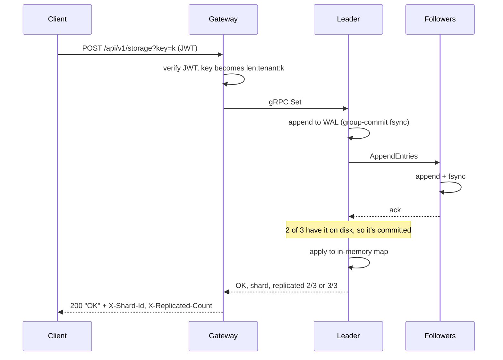
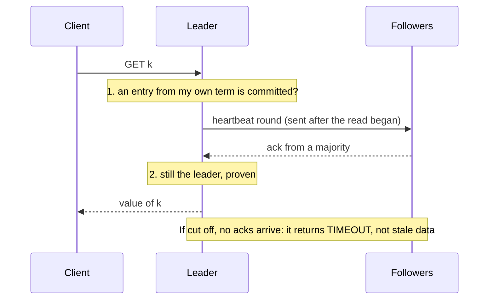
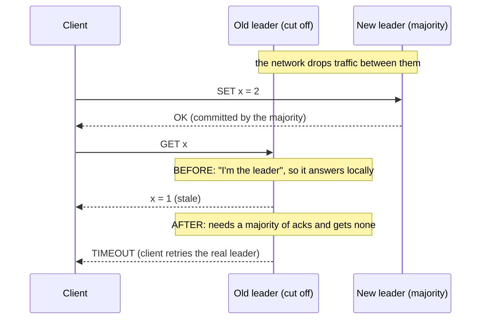
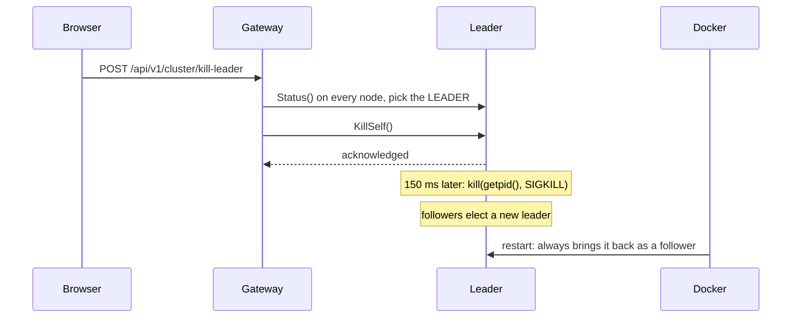
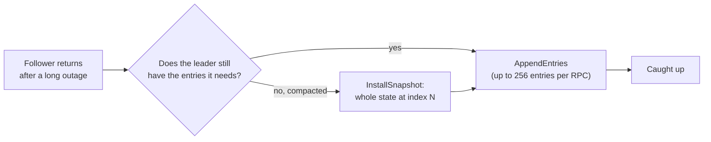

# Request flows

## A write (SET)



If the gateway reaches a follower, the follower replies `NOT_LEADER` with
the leader's address and the gateway retries there.

## A read (GET)



## A partition, before and after the fix



## Leader failure

```mermaid
sequenceDiagram
  participant L as Old leader
  participant A as Follower A
  participant B as Follower B
  L--xA: crashes, heartbeats stop
  Note over A: election timeout (800–1,600 ms)
  A->>B: PreVote: would you vote for me?
  B-->>A: yes (hasn't heard from a leader)
  A->>B: RequestVote, term + 1
  B-->>A: vote granted (A's log is up to date)
  Note over A: A is the new leader and appends a no-op entry
  Note over L: Docker restarts it; it rejoins as a follower and catches up
```

Measured from `docker kill` to a new leader confirmed: 999–2,351 ms.

## Kill Leader (Cluster Console)



The engine kills itself rather than the gateway calling `docker kill`,
because giving the gateway the Docker socket would be root access to the
host. The container runs with `init: true`: without an init process, the
engine is PID 1, and Linux ignores signals that PID 1 sends to itself.

## Catching up after a long outage


